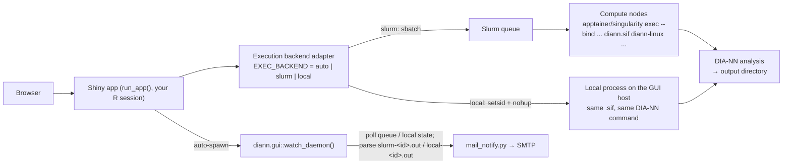

English | [简体中文](README.zh-CN.md)

# DIANN GUI

A Shiny application, packaged as an R package, that puts
[DIA-NN](https://github.com/vdemichev/DiaNN) behind a browser: build commands,
submit them as Slurm batch jobs **or run them directly on the local Linux host**
(always through the official DIA-NN container image Apptainer/Singularity
`.sif`), and monitor queues, logs and results — from your own R session, with
your own account. Slurm is optional since v1.12: the execution backend is
auto-detected, or can be pinned to `slurm` or `local`.

> The web UI and the bundled documentation are in Chinese. Configuration and
> this README are in English.

## Install and run (per-user, no admin)

Every user installs the package into **their own R library** and runs the app
from **their own R session**. Jobs are submitted as that user, outputs are owned
by that user, and file permissions are plain Unix — no third-party run user, no
shared queue identity, no admin ACL work.

```r
# 1) install into your user library — pick one
install.packages("diann.gui", repos = c(SITE = "<site drat/miniCRAN>", getOption("repos")))
# air-gapped cluster (admin stages the tarball on shared storage):
install.packages("/share/app/tools/R/diann.gui_1.13.0.tar.gz", repos = NULL, type = "source")
# with internet access:
remotes::install_github("zhangdong360/diann-gui")

# 2) load and self-check (optional, recommended)
library(diann.gui)
diann.gui::doctor()

# 3) run (picks a free port, prints the URL and an SSH-tunnel hint)
diann.gui::run_app()
```

There is no `R CMD INSTALL` step from a clone, no launcher script, and no
system-wide installation. The app is just an R package: everything it needs
(`shiny`, `shinydashboard`, `shinyFiles`, `htmltools`) is installed with it.

- **Remote cluster?** `run_app()` prints a ready-to-paste
  `ssh -L <port>:127.0.0.1:<port> user@cluster` hint when it detects an SSH
  session.
- **RStudio Server users**: `run_app()` opens the app in the Viewer pane;
  RStudio proxies the port automatically.
- **Fixed port**: `run_app(port = 3838)`.
- **RStudio "Run App" / `shiny::runApp()`**: the repo root ships an optional
  `app.R` shim (`diann.gui::run_app(app_only = TRUE)`) so both keep working.
  It is not required for normal use — `diann.gui::run_app()` is the entry point.
- **Embedding / custom launcher**: `run_app(app_only = TRUE)` returns the
  app object without starting a server.
- **Per-user settings**: `diann.gui::init_config()` writes
  `~/.diann_gui/config.R` (it auto-detects the execution backend — `slurm` or
  `local` — as well as Slurm partitions, apptainer candidates and common
  `diann*.sif` directories). A file pointed to by the `DIANN_GUI_CONFIG` env var
  is honored; `DIANN_GUI_EXEC_BACKEND` overrides `EXEC_BACKEND` for a single
  launch without editing the file. Mail credentials live in
  `~/.diann_gui/mail_config.txt` (`DIANN_GUI_MAIL_CONF` is also supported).
- **One-time admin setup**: place the `diann*.sif` images in a world-readable
  shared directory (e.g. `/share/app/tools/diann`). That is all — the R package
  and its dependencies install per user, and data lives in each user's home.

State is per user: `~/diann_gui_notify_state.rds`,
`~/diann_gui_jobs_registry.rds`, the watcher pid/log, and the apptainer probe
cache under `~/.diann_gui/`. Local-mode jobs additionally keep their job records
and ID sequence in `~/diann_gui_local_jobs.rds` and `~/diann_gui_local_seq`
(next to the notify state file), keeping the 300 most recent records.

## Features

- **No command line for end users** — lab members pick a DIA-NN container
  version, the apptainer runtime, RAW/FASTA/library files, output directory and
  80+ grouped DIA-NN parameters from a web form; the exact job script is
  generated and submitted for them — as a Slurm batch job or as a local process.
- **Optional execution backend (v1.12)** — `EXEC_BACKEND` = `auto` (default) |
  `slurm` | `local`, overridable with the `DIANN_GUI_EXEC_BACKEND` environment
  variable. `auto` uses Slurm when `sbatch` is on `PATH` (behaviour identical to
  v1.11) and runs locally otherwise. Both backends use the **same** generated
  DIA-NN command and the **same** `.sif` image — only the executor differs.
  Safety valves: `auto` refuses to fall back to local execution when Slurm
  traces are present but `sbatch` is missing (login-node protection).
- **apptainer runtime selection** — the GUI auto-detects `apptainer` /
  `singularity` binaries (PATH, `APPTAINER_PATHS`, common install locations,
  conda envs), resolves each version and lists them as candidates, like the
  DIA-NN version dropdown. If nothing is found, a manual path can be entered and
  verified. The selected binary is written into the job script as the first
  choice, with a candidate-dir → PATH → module fallback chain for compute nodes
  that differ from the login node.
- **Multi-version support** — the DIA-NN version dropdown is built by scanning
  configured directories for `diann*.sif` images (numeric version ordering).
- **Command import** — paste an existing DIA-NN command line (e.g. from a
  Windows `diann.exe` script) and the GUI maps every recognized flag back
  into the form, including `--dir`/`--dir-all` directory mode.
- **Three-level validation** — blocking errors, warnings and informational
  hints catch common mistakes (missing RAW files, flag combinations,
  leftover bare flags from pasted commands, unwritable output dir, invisible
  apptainer) before a job is submitted.
- **Live command preview** — see the exact DIA-NN arguments and the full job
  script (Slurm header + shared body, or the local execution script) before
  submitting.
- **Job dashboard** — auto-refreshing `squeue` view in Slurm mode (or the local
  job list in local mode), `sacct` history (when Slurm accounting is on),
  `scancel` / local process-group cancel, and a log viewer that automatically
  locates `slurm-<jobid>.out/.err` or `local-<jobid>.out/.err` according to the
  job's backend.
- **Four-layer job status** — scheduler state (Slurm, or the local process
  state mapped to the same names) → program exit code (`.rc` file) → artifact
  check → display label (`成功/失败/待核实/未知`), used by both the dashboard
  and the completion e-mail.
- **Email notifications (optional)** — a per-user watcher daemon
  (`diann.gui::watch_daemon()`, spawned automatically) polls the execution
  backend (Slurm queue or local job state file) and sends completion emails via
  `mail_notify.py` when jobs finish; works on clusters where compute nodes have
  no outbound network.
- **Parameter reference** — an in-app searchable DIA-NN flag reference.

## Architecture



## Requirements

| Component | Notes |
|---|---|
| **Linux** | any x86_64 Linux host for per-user self-hosted runs (no admin) |
| **Slurm** | *optional* — needed only for the `slurm` backend (`sbatch`/`squeue`/`sacct`/`scancel`/`scontrol`). With `EXEC_BACKEND=auto` the app uses Slurm when `sbatch` is on `PATH`, and otherwise runs jobs locally on the GUI host |
| Local-mode tools | `bash`, `nohup`, `timeout` are required for local execution; `setsid` is recommended (without it cancellation falls back to killing the process tree), `/proc` must be readable |
| **R** ≥ 4.1 | per-user library; dependencies install with the package |
| **Apptainer or Singularity** | plus a DIA-NN `.sif` container image (login node may not have apptainer — the GUI accepts a compute-node-only path). **`.sif` requires apptainer ≥ 1.0 or singularity ≥ 3.0**; 2.x only reads `.simg` |
| **python3** | optional, only for email notifications (standard library only) |

## Configuration (`~/.diann_gui/config.R`)

All variables are optional; sensible defaults are used when unset.
`diann.gui::init_config()` creates the file from the bundled template.
`SLURM_*` keys are only used by the Slurm backend and the `LOCAL_*` keys only by
the local backend. `EXEC_BACKEND` can be overridden per launch with the
`DIANN_GUI_EXEC_BACKEND` environment variable.

| Variable | Purpose | Default |
|---|---|---|
| `SIF_DIRS` | Directories scanned recursively for **all `*.sif`** (any file name) | *(none — set it, or type a SIF path in the GUI)* |
| `DEFAULT_SIF` | Image preselected in the dropdown | first scanned image |
| `DATA_HOME` | Root of the browsable data tree (FASTA/RAW/output) | home directory |
| `BASE_VOLUMES` | Named roots exposed to the file browser (import path guard) | `c(Data = DATA_HOME)` |
| `CON_FASTA` | Built-in contaminant (cRAP) FASTA | *(none)* |
| `SLURM_PARTITIONS` | Partitions offered in the submit form | `c("compute")` |
| `APPTAINER_PATHS` | Directories scanned for `apptainer`/`singularity` **and** used as the job-script fallback | *(empty)* |
| `DEFAULT_APPTAINER` | Runtime preselected in the apptainer dropdown | highest available version |
| `APPTAINER_STRICT_CHECK` | `TRUE` = block submit when the selected runtime is not runnable on the GUI node | `FALSE` (warn only) |
| `APPTAINER_MODULE_FALLBACK` | Environment module loaded as a fallback | *(empty — no module)* |
| `BIND_PATHS` | Host paths bind-mounted into the container (`--bind`) | *(empty)* |
| `EXEC_BACKEND` | Execution backend: `"auto"` (detect), `"slurm"` or `"local"` | `"auto"` |
| `LOCAL_REQUIRE_EXCLUSIVE_HOST` | `auto`-mode safety valve: refuse to fall back to local execution when Slurm traces are detected but `sbatch` is missing (HPC login-node protection) | `TRUE` |
| `LOCAL_NICE` | `nice` value applied to local job processes | `10` |
| `LOCAL_TIMEOUT_GRACE` | Seconds between SIGTERM and SIGKILL when a local job reaches its time limit | `30` |
| `LOCAL_MAX_JOBS` | Local concurrency cap: `0` = unlimited; `>0` rejects new submissions once reached (no queueing) | `0` |
| `LOCAL_MEM_ADVISORY` | Compare requested memory with `/proc/meminfo` before submitting (warning only — memory cannot be enforced locally) | `TRUE` |
| `MAIL_PYTHON` | python3 used for email notifications | `python3` from `PATH` |

## apptainer runtime

The first panel in the GUI («1. apptainer 运行环境») is filled at startup:

- candidates are discovered from `PATH`, `APPTAINER_PATHS`, `/usr/bin`,
  `/usr/local/bin`, `/opt/apptainer/bin`, conda envs under `$HOME`, …;
- each candidate is probed with `--version` (cached for 24 h, invalidated by
  mtime/size), so multiple versions are listed like the SIF dropdown;
- if nothing is found, the manual-path input opens automatically; «识别并验证»
  checks the path and shows the detected version;
- the choice is embedded in the sbatch script, and the job falls back to
  `APPTAINER_PATHS` → `PATH` → `module load` → `singularity` when the compute
  node cannot see that path.

**Version requirement: `.sif` needs apptainer ≥ 1.0 or singularity ≥ 3.0** (SIF
has been the image format since Singularity 3.0). `singularity 2.x` answers
`--version` fine but only understands squashfs/ext3 `.simg`, so a `.sif` fails
with `Unknown image format/type`. The dropdown, self-check panel, both
verification modes and the pre-submit check flag such candidates as
«⚠ 不支持 SIF» and block submission.

## Building the DIA-NN container image (`.sif`)

The GUI never ships DIA-NN binaries, images, or build scripts — **each user
builds their own `.sif`, following the official DIA-NN instructions**
(free for academic use; redistribution of binaries/images is not permitted —
see the maintainer's note in [DiaNN issue #1202](https://github.com/vdemichev/DiaNN/issues/1202)):

- the official repository README (https://github.com/vdemichev/DiaNN) — the
  release ships an image-build script for Docker, and the README explains
  converting a Docker image to `.sif` with apptainer/singularity;
- [DiaNN issue #1202](https://github.com/vdemichev/DiaNN/issues/1202) — a
  community-maintained Dockerfile discussion (build steps there are authoritative,
  not this document).

**What the GUI requires from your image** (this is our only contract):

1. the DIA-NN binary directory must be **inside the container's `PATH`** — the
   GUI invokes `diann-linux` as a bare command; without PATH the job fails with
   "容器内找不到 diann-linux";
2. verify after building: `apptainer exec diann-<ver>.sif diann-linux --version`
   must print `DIA-NN <ver> …`;
3. put the `.sif` on storage visible to the compute nodes and add its directory
   to `SIF_DIRS` — **any file name works**: since v1.13 the GUI scans all
   `*.sif`, reads the real version from inside the container (cached per
   size+mtime), sorts numerically (2.10.0 before 2.9.1) and preselects the
   highest identified image.

Runtime notes: apptainer must be installed setuid-root (`.deb`) or provided as
an admin-built conda env; the GUI node and the compute nodes must both see it.
If the compute nodes cannot, point `APPTAINER_PATHS` at them — the generated
job script already falls back `APPTAINER_PATHS` → `PATH` → `module load` →
`singularity`. Do **not** redistribute the built `.sif` (or any DIA-NN
binary); each user builds their own.

## Running without Slurm (local mode)

Since v1.12 the app does not require Slurm. With the default
`EXEC_BACKEND = "auto"`:

- if `sbatch` is on `PATH`, jobs go to the Slurm cluster exactly as in v1.11;
- if it is not, jobs run as **local processes on the GUI host** — no scheduler,
  no queue, no `sbatch`. The app header shows `执行后端: 本地单机`.

Local mode still uses Apptainer/Singularity and the same `diann*.sif` image, so
the DIA-NN command and container setup are identical to Slurm mode. What
changes:

| Aspect | Local mode |
|---|---|
| Where it runs | the Linux host that runs `run_app()` |
| Job identity | integer IDs starting at `1000001` (persisted per user) |
| Logs | `<output dir>/local-<JobID>.out` / `.err` (Slurm mode keeps `slurm-<JobID>.out` / `.err`) |
| Script | still saved under `<output dir>/diann_gui_scripts/`; exit code in `<script>.rc` |
| Lifetime | detached via `setsid` + `nohup`; closing the browser does not stop the job |
| Time limit | enforced by `timeout` (`rc=124` → `超时`); `LOCAL_TIMEOUT_GRACE` controls the TERM→KILL grace period |
| Memory | advisory only: checked against `/proc/meminfo` before submit, never enforced |
| CPU | `--threads`; no scheduler bookkeeping |
| Queueing | none; `LOCAL_MAX_JOBS` can cap concurrency (submission is rejected when reached) |
| Cancelling | kills the local process group (same-UID check); status becomes `已取消` |
| Status / e-mail / monthly report | same four-layer status synthesis, notification watcher and `usage_report()` as Slurm mode |

UI differences in local mode: the header shows `执行后端: 本地单机`; the resource
box is titled `6. 运行资源 (本地)` and offers no partition; the submit button
reads `提交本地任务`; the monitor page hides the `sinfo` node box and titles its
blocks `本地运行任务` / `近期历史 (本地作业)`; the log viewer targets
`local-<ID>.out`. The Slurm-mode UI is unchanged from v1.11, so existing
screenshots remain valid.

**HPC login nodes are protected.** If the host looks like a Slurm node
(`squeue`/`sacct`/`scontrol`/`sinfo` on `PATH`, `/etc/slurm*`, or `SLURM_CONF`)
but `sbatch` is missing, `auto` refuses to silently run locally and `run_app()`
stops with an explanatory error. Either load the Slurm module / fix `PATH`
(recommended), or — only if this really is a standalone Linux server — pin the
backend explicitly:

```r
# ~/.diann_gui/config.R
EXEC_BACKEND <- "local"
# or for one launch, before run_app():
# Sys.setenv(DIANN_GUI_EXEC_BACKEND = "local")
```


Out of scope in this version: native DIA-NN binaries (no container), cloud
execution, Windows, and PBS/LSF. Local mode is Linux-only and still requires
Apptainer/Singularity plus a `.sif` image, exactly like Slurm mode.

## Email notifications (optional)

```bash
mkdir -p ~/.diann_gui
cp /path/to/inst/config/mail_config.example.txt ~/.diann_gui/mail_config.txt
chmod 600 ~/.diann_gui/mail_config.txt
```

- `smtp_port` `465` uses SSL, any other port uses STARTTLS (a failed STARTTLS
  aborts instead of sending credentials in clear text). Use an SMTP
  **authorization code**, not the login password.
- When the file is absent the whole feature is dormant: no queueing, no
  watcher daemon, and the submit form simply notes that mail is disabled.
- Self-test: `python3 mail_notify.py --check` / `--self-test` (the script path is
  `system.file("python", "mail_notify.py", package = "diann.gui")`);
  `Rscript -e 'diann.gui::watch_daemon(once = TRUE)'` runs one watcher tick.

## Troubleshooting

**`run_app()` stops with `auto` mode refusing local execution.**
The host shows Slurm traces (client commands or `/etc/slurm*`) but `sbatch` is
not on `PATH`. The app refuses to silently run compute tasks on what is probably
an HPC login node. Fix `PATH` / load the Slurm module and restart; only if the
machine is a genuine standalone Linux server, set `EXEC_BACKEND <- "local"` (or
`DIANN_GUI_EXEC_BACKEND=local`) to override.

**Local mode: submission is blocked because apptainer cannot be verified.**
In local mode jobs run on the GUI host, so the apptainer runtime must really
work there — the pre-submit check is a real `--version`/SIF check and a failure
blocks submission (unlike Slurm mode, where a compute-node-only path is accepted
with a warning). Pick and verify a runnable apptainer/singularity in panel
`1. apptainer 运行环境`, or submit to a Slurm cluster instead.

**Where is my local job log?**
Local jobs write `<output dir>/local-<JobID>.out` and `.err` — not
`slurm-<JobID>.out`. The log viewer resolves the right file name from the job's
backend automatically; local JobIDs start at `1000001`. The generated script,
the `.rc` exit code and the `_desc.txt` project note live under
`<output dir>/diann_gui_scripts/`.

**A local job shows `超时` (timeout) although DIA-NN was still working.**
Local time limits are enforced by `timeout` (exit code 124 → `超时`), so a tight
`time_h` kills the process. Leave the time limit empty for unlimited, or raise
it.

**Can Slurm and local jobs coexist?**
Each submission is recorded with its backend in the job registry (schema v3);
the dashboard, e-mail watcher and `usage_report(month=...)` handle records from
both backends (local job history keeps the 300 most recent local records). Old
v1.11-and-earlier registries are read as Slurm records.

## Documentation

- [`docs/DIANN_GUI_新手指南.html`](docs/DIANN_GUI_新手指南.html) — beginner's
  guide with annotated screenshots (self-contained, offline).
- [`docs/DIANN_GUI_技术手册.md`](docs/DIANN_GUI_技术手册.md) — full technical
  manual: architecture, every control, workflows, notification internals,
  troubleshooting.
- **In-app parameter reference**: since v1.13 the DIA-NN documentation snapshot
  is no longer bundled (the copyright belongs to the DIA-NN authors and the
  terms do not permit redistribution). To enable the in-app parameter
  quick-reference, save the official command-line reference as
  `DIANN_param_reference.md` in your working directory — the GUI picks it up
  automatically.

*(Documentation is in Chinese.)*

## Tests

```bash
Rscript -e 'testthat::test_dir("tests/testthat", stop_on_failure = TRUE)'
python3 -m unittest discover -s tests/python
```

GitHub Actions runs the testthat suite, Python unit tests, a synthetic-ID
allowlist scan, an `R CMD check`, a package-level launch smoke, and the browser
end-to-end regression (three real-paste fixtures + apptainer selection).

Real-world regression fixtures (39- and 796-file search commands plus a
Windows-GUI predicted-library command and a directory-mode command,
`tests/fixtures/`) are pinned by `tests/testthat/test-import-fixtures.R`.
`test-consistency.R` adds class-level invariants between the flag maps, UI
widgets and import-reset lists.

`test-backend.R` covers both execution backends offline (fake apptainer and a
fake DIA-NN payload, no real Slurm/container/RAW data): backend resolution and
auto-detection, the log-name contract, the script body shared by both backends,
local submit → success/failure/timeout/cancel, PID-reuse protection, and
"submitting without `sbatch` returns an error instead of crashing the Shiny
session". CI exercises this local-submission path on a runner that has no Slurm.

**Regression policy**: every production incident must be pinned as a fixture or
contract test in the same commit that fixes it.

**Anonymization policy**: fixtures and docs may only contain synthetic
identifiers (`/share/home/demo`, `demo_sample_NNN.raw`,
`human_proteome*.fasta`, …). `tests/check_synthetic_ids.py` enforces this in CI.

Browser end-to-end check (spawns a local instance, pastes the fixtures, checks
the apptainer panel):

```bash
tests/e2e/run_e2e.sh
tests/e2e/run_e2e.sh --url http://localhost:3838/diann_gui/   # re-check after deploy
```

Requires selenium + geckodriver + Firefox.

## Monthly usage report

```bash
Rscript -e 'diann.gui::usage_report(month = "2026-10", out_dir = "/path/to/reports")'
```

The report breaks usage down per job with a backend column (`Slurm` / `本地`),
so mixed Slurm + local records are counted separately.

Cron example (first day of each month, for the previous month):

```
0 9 1 * *  Rscript -e 'diann.gui::usage_report(month = format(Sys.Date() - 1, "%Y-%m"), out_dir = "/path/to/reports")'
```

## Removed in v1.13: legacy central shiny-server deployment

v1.13 removed the legacy central shiny-server shared-account deployment (one
shared instance, all jobs running as the server's `run_as` user — no per-user
isolation). Use per-user self-hosting instead: each user installs the package
into their own library and runs `diann.gui::run_app()` in their own R session;
jobs are then submitted under their own account. For shared read access to
output directories, use standard Unix groups/ACL. If you still need the old
central deployment, use v1.12 or the `central-shiny-server` branch (kept as a
historical archive).

## License

[MIT](LICENSE) — free to use, modify and redistribute.

## Acknowledgements

Built on [DIA-NN](https://github.com/vdemichev/DiaNN) by V. Demichev et al.;
please cite DIA-NN for any analyses performed with this GUI.
