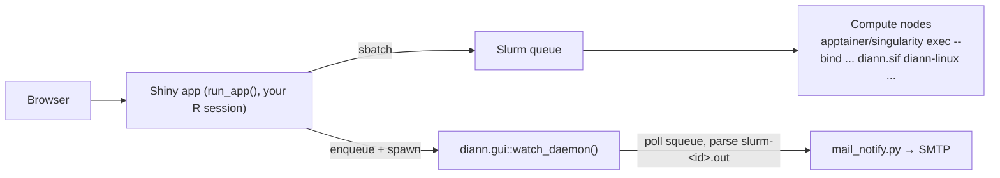

English | [简体中文](README.zh-CN.md)

# DIANN GUI

A Shiny application, packaged as an R package, that puts
[DIA-NN](https://github.com/vdemichev/DiaNN) behind a browser: build commands,
submit them as Slurm batch jobs running the official DIA-NN container image
(Apptainer/Singularity `.sif`), and monitor queues, logs and results — from your
own R session, with your own account.

> The web UI and the bundled documentation are in Chinese. Configuration and
> this README are in English.

## Install and run (per-user, no admin)

Every user installs the package into **their own R library** and runs the app
from **their own R session**. Jobs are submitted as that user, outputs are owned
by that user, and file permissions are plain Unix — no third-party run user, no
shared queue identity, no admin ACL work.

```r
# 1) install into your user library — pick one
install.packages("diann.gui", repos = c(SITE = "<site drat/miniCRAN>", getOption("repos")))
# air-gapped cluster (admin stages the tarball on shared storage):
install.packages("/share/app/tools/R/diann.gui_1.11.0.tar.gz", repos = NULL, type = "source")
# with internet access:
remotes::install_github("zhangdong360/diann-gui")

# 2) load and self-check (optional, recommended)
library(diann.gui)
diann.gui::doctor()

# 3) run (picks a free port, prints the URL and an SSH-tunnel hint)
diann.gui::run_app()
```

There is no `R CMD INSTALL` step from a clone, no launcher script, and no
system-wide installation. The app is just an R package: everything it needs
(`shiny`, `shinydashboard`, `shinyFiles`, `htmltools`) is installed with it.

- **Remote cluster?** `run_app()` prints a ready-to-paste
  `ssh -L <port>:127.0.0.1:<port> user@cluster` hint when it detects an SSH
  session.
- **RStudio Server users**: `run_app()` opens the app in the Viewer pane;
  RStudio proxies the port automatically.
- **Fixed port**: `run_app(port = 3838)`.
- **RStudio "Run App" / `shiny::runApp()`**: the repo root ships an optional
  `app.R` shim (`diann.gui::run_app(app_only = TRUE)`) so both keep working.
  It is not required for normal use — `diann.gui::run_app()` is the entry point.
- **Embedding / legacy shiny-server**: `run_app(app_only = TRUE)` returns the
  app object without starting a server.
- **Per-user settings**: `diann.gui::init_config()` writes
  `~/.diann_gui/config.R` (it can auto-detect Slurm partitions, apptainer
  candidates and common `diann*.sif` directories). A file pointed to by the
  `DIANN_GUI_CONFIG` env var is honored. Mail credentials live in
  `~/.diann_gui/mail_config.txt` (`DIANN_GUI_MAIL_CONF` is also supported).
- **One-time admin setup**: place the `diann*.sif` images in a world-readable
  shared directory (e.g. `/share/app/tools/diann`). That is all — the R package
  and its dependencies install per user, and data lives in each user's home.

State is per user: `~/diann_gui_notify_state.rds`,
`~/diann_gui_jobs_registry.rds`, the watcher pid/log, and the apptainer probe
cache under `~/.diann_gui/`.

## Features

- **No command line for end users** — lab members pick a DIA-NN container
  version, the apptainer runtime, RAW/FASTA/library files, output directory and
  80+ grouped DIA-NN parameters from a web form; the exact `sbatch` script is
  generated and submitted for them.
- **apptainer runtime selection** — the GUI auto-detects `apptainer` /
  `singularity` binaries (PATH, `APPTAINER_PATHS`, common install locations,
  conda envs), resolves each version and lists them as candidates, like the
  DIA-NN version dropdown. If nothing is found, a manual path can be entered and
  verified. The selected binary is written into the job script as the first
  choice, with a candidate-dir → PATH → module fallback chain for compute nodes
  that differ from the login node.
- **Multi-version support** — the DIA-NN version dropdown is built by scanning
  configured directories for `diann*.sif` images (numeric version ordering).
- **Command import** — paste an existing DIA-NN command line (e.g. from a
  Windows `diann.exe` script) and the GUI maps every recognized flag back
  into the form, including `--dir`/`--dir-all` directory mode.
- **Three-level validation** — blocking errors, warnings and informational
  hints catch common mistakes (missing RAW files, flag combinations,
  leftover bare flags from pasted commands, unwritable output dir, invisible
  apptainer) before a job is submitted.
- **Live command preview** — see the exact DIA-NN arguments and the full
  Slurm script before submitting.
- **Job dashboard** — auto-refreshing `squeue` view, `sacct` history (when
  Slurm accounting is on), `scancel`, and a log viewer that automatically
  locates `slurm-<jobid>.out/.err`.
- **Four-layer job status** — Slurm state → program exit code (`.rc` file) →
  artifact check → display label (`成功/失败/待核实/未知`), used by both the
  dashboard and the completion e-mail.
- **Email notifications (optional)** — a per-user watcher daemon
  (`diann.gui::watch_daemon()`, spawned automatically) polls the queue and
  sends completion emails via `mail_notify.py` when jobs leave the queue;
  works on clusters where compute nodes have no outbound network.
- **Parameter reference** — an in-app searchable DIA-NN flag reference.

## Architecture



## Requirements

| Component | Notes |
|---|---|
| Linux with **Slurm** | the app submits via `sbatch`/`squeue`/`sacct`/`scancel`/`scontrol` |
| **R** ≥ 4.1 | per-user library; dependencies install with the package |
| **Apptainer or Singularity** | plus a DIA-NN `.sif` container image (login node may not have apptainer — the GUI accepts a compute-node-only path). **`.sif` requires apptainer ≥ 1.0 or singularity ≥ 3.0**; 2.x only reads `.simg` |
| **python3** | optional, only for email notifications (standard library only) |

## Configuration (`~/.diann_gui/config.R`)

All variables are optional; sensible defaults are used when unset.
`diann.gui::init_config()` creates the file from the bundled template.

| Variable | Purpose | Default |
|---|---|---|
| `SIF_DIRS` | Directories scanned recursively for `diann*.sif` | *(none — set it, or type a SIF path in the GUI)* |
| `DEFAULT_SIF` | Image preselected in the dropdown | first scanned image |
| `DATA_HOME` | Root of the browsable data tree (FASTA/RAW/output) | home directory |
| `BASE_VOLUMES` | Named roots exposed to the file browser (import path guard) | `c(Data = DATA_HOME)` |
| `CON_FASTA` | Built-in contaminant (cRAP) FASTA | *(none)* |
| `SLURM_PARTITIONS` | Partitions offered in the submit form | `c("compute")` |
| `APPTAINER_PATHS` | Directories scanned for `apptainer`/`singularity` **and** used as the job-script fallback | *(empty)* |
| `DEFAULT_APPTAINER` | Runtime preselected in the apptainer dropdown | highest available version |
| `APPTAINER_STRICT_CHECK` | `TRUE` = block submit when the selected runtime is not runnable on the GUI node | `FALSE` (warn only) |
| `APPTAINER_MODULE_FALLBACK` | Environment module loaded as a fallback | *(empty — no module)* |
| `BIND_PATHS` | Host paths bind-mounted into the container (`--bind`) | *(empty)* |
| `SHARED_GROUP` | Legacy shared-output group repair (multi-account shared instance) | *(empty — disabled)* |
| `MAIL_PYTHON` | python3 used for email notifications | `python3` from `PATH` |

## apptainer runtime

The first panel in the GUI («1. apptainer 运行环境») is filled at startup:

- candidates are discovered from `PATH`, `APPTAINER_PATHS`, `/usr/bin`,
  `/usr/local/bin`, `/opt/apptainer/bin`, conda envs under `$HOME`, …;
- each candidate is probed with `--version` (cached for 24 h, invalidated by
  mtime/size), so multiple versions are listed like the SIF dropdown;
- if nothing is found, the manual-path input opens automatically; «识别并验证»
  checks the path and shows the detected version;
- the choice is embedded in the sbatch script, and the job falls back to
  `APPTAINER_PATHS` → `PATH` → `module load` → `singularity` when the compute
  node cannot see that path.

**Version requirement: `.sif` needs apptainer ≥ 1.0 or singularity ≥ 3.0** (SIF
has been the image format since Singularity 3.0). `singularity 2.x` answers
`--version` fine but only understands squashfs/ext3 `.simg`, so a `.sif` fails
with `Unknown image format/type`. The dropdown, self-check panel, both
verification modes and the pre-submit check flag such candidates as
«⚠ 不支持 SIF» and block submission.

## Email notifications (optional)

```bash
mkdir -p ~/.diann_gui
cp /path/to/inst/config/mail_config.example.txt ~/.diann_gui/mail_config.txt
chmod 600 ~/.diann_gui/mail_config.txt
```

- `smtp_port` `465` uses SSL, any other port uses STARTTLS (a failed STARTTLS
  aborts instead of sending credentials in clear text). Use an SMTP
  **authorization code**, not the login password.
- When the file is absent the whole feature is dormant: no queueing, no
  watcher daemon, and the submit form simply notes that mail is disabled.
- Self-test: `python3 mail_notify.py --check` / `--self-test` (the script path is
  `system.file("python", "mail_notify.py", package = "diann.gui")`);
  `Rscript -e 'diann.gui::watch_daemon(once = TRUE)'` runs one watcher tick.

## Documentation

- [`docs/DIANN_GUI_新手指南.html`](docs/DIANN_GUI_新手指南.html) — beginner's
  guide with annotated screenshots (self-contained, offline).
- [`docs/DIANN_GUI_技术手册.md`](docs/DIANN_GUI_技术手册.md) — full technical
  manual: architecture, every control, workflows, notification internals,
  troubleshooting.
- [`inst/docs/DIANN_param_reference.md`](inst/docs/DIANN_param_reference.md) —
  the in-app parameter reference data source.

*(Documentation is in Chinese.)*

## Tests

```bash
Rscript -e 'testthat::test_dir("tests/testthat", stop_on_failure = TRUE)'
python3 -m unittest discover -s tests/python
```

GitHub Actions runs the testthat suite, Python unit tests, a synthetic-ID
allowlist scan, an `R CMD check`, a package-level launch smoke, and the browser
end-to-end regression (three real-paste fixtures + apptainer selection).

Real-world regression fixtures (39- and 796-file search commands plus a
Windows-GUI predicted-library command and a directory-mode command,
`tests/fixtures/`) are pinned by `tests/testthat/test-import-fixtures.R`.
`test-consistency.R` adds class-level invariants between the flag maps, UI
widgets and import-reset lists.

**Regression policy**: every production incident must be pinned as a fixture or
contract test in the same commit that fixes it.

**Anonymization policy**: fixtures and docs may only contain synthetic
identifiers (`/share/home/demo`, `demo_sample_NNN.raw`,
`human_proteome*.fasta`, …). `tests/check_synthetic_ids.py` enforces this in CI.

Browser end-to-end check (spawns a local instance, pastes the fixtures, checks
the apptainer panel):

```bash
tests/e2e/run_e2e.sh
tests/e2e/run_e2e.sh --url http://localhost:3838/diann_gui/   # re-check after deploy
```

Requires selenium + geckodriver + Firefox.

## Monthly usage report

```bash
Rscript -e 'diann.gui::usage_report(month = "2026-10", out_dir = "/path/to/reports")'
```

Cron example (first day of each month, for the previous month):

```
0 9 1 * *  Rscript -e 'diann.gui::usage_report(month = format(Sys.Date() - 1, "%Y-%m"), out_dir = "/path/to/reports")'
```

## Legacy: central shiny-server deployment (not recommended)

One shared instance, all jobs running as the server's `run_as` user — there is
**no per-user isolation**, and everyone can see the shared notification records.
Use it only if per-user installs are impossible. Entry point:

```r
# app.R in the site directory (needs config.R next to it)
diann.gui::run_app(app_only = TRUE)
```

See [`docs/legacy/shiny-server-config.example.R`](docs/legacy/shiny-server-config.example.R)
for a sanitized site-config example.

## License

[MIT](LICENSE) — free to use, modify and redistribute.

## Acknowledgements

Built on [DIA-NN](https://github.com/vdemichev/DiaNN) by V. Demichev et al.;
please cite DIA-NN for any analyses performed with this GUI.
