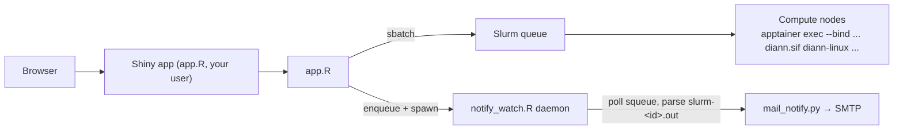

English | [简体中文](README.zh-CN.md)

# DIANN GUI

A Shiny web application that puts [DIA-NN](https://github.com/vdemichev/DiaNN)
behind a browser: build commands, submit them as Slurm batch jobs running the
official DIA-NN container image (Apptainer/Singularity `.sif`), and monitor
queues, logs and results — all from one dashboard on your HPC cluster.

> The web UI and the bundled documentation are in Chinese (screenshots-based
> beginner guide + full technical manual). Configuration and this README are
> in English.

## Run it yourself (self-hosted — recommended)

Every user runs their own copy with their own account: jobs are submitted as
you, outputs are owned by you, and file permissions are plain Unix — no
third-party run user, no shared queue identity, no admin ACL work.

```bash
git clone https://github.com/zhangdong360/diann-gui.git
cd diann_gui
bin/diann-gui --init     # optional: create ~/.diann_gui/config.R from the template
bin/diann-gui            # start on a random port; prints the URL
```

- **Remote cluster?** open an SSH tunnel first:
  `ssh -L <port>:localhost:<port> user@cluster`, then open
  `http://localhost:<port>` in your local browser.
- **RStudio Server users**: run `bin/diann-gui` in the built-in Terminal —
  RStudio proxies the port and pops the app up in a browser window
  automatically. Same per-user identity, zero admin setup.
- **Configuration** lives in `~/.diann_gui/config.R` (template:
  `config.example.R`; a file pointed to by the `DIANN_GUI_CONFIG` env var is
  also honored). Typical settings: `SIF_DIRS` pointing at a shared read-only
  DIA-NN image directory (e.g. `/share/app/tools/diann`), `EXTRA_LIB` when the
  R packages live in a site library, and optional email credentials
  (`~/.diann_gui/mail_config.txt`; the `DIANN_GUI_MAIL_CONF` env var is also
  supported).
- **One-time admin setup**: place the `diann*.sif` images in a world-readable
  shared directory (e.g. `/share/app/tools/diann`) and install the three R
  packages (`shiny`, `shinydashboard`, `shinyFiles`) into a site library — or
  point `EXTRA_LIB` at one. That is all; your data lives in your own home.

A central shiny-server deployment (one shared instance at a fixed URL, all
jobs running as the server's run user) is still supported as a deployment
variant — see [Central deployment (shiny-server)](#central-deployment-shiny-server).

## Features

- **No command line for end users** — lab members pick a DIA-NN container
  version, RAW/FASTA/library files, output directory and 80+ grouped DIA-NN
  parameters from a web form; the exact `sbatch` script is generated and
  submitted for them.
- **Multi-version support** — the version dropdown is built by scanning
  configured directories for `diann*.sif` images.
- **Command import** — paste an existing DIA-NN command line (e.g. from a
  Windows `diann.exe` script) and the GUI maps every recognized flag back
  into the form.
- **Three-level validation** — blocking errors, warnings and informational
  hints catch common mistakes (missing RAW files, flag combinations,
  leftover bare flags from pasted commands) before a job is submitted.
- **Live command preview** — see the exact DIA-NN arguments and the full
  Slurm script before submitting.
- **Job dashboard** — auto-refreshing `squeue` view, `sacct` history (when
  Slurm accounting is on), `scancel`, and a log viewer that automatically
  locates `slurm-<jobid>.out/.err` for a job ID (manual path → session
  history → persistent submission registry → `scontrol` → sacct workdir).
- **Email notifications (optional)** — a standalone watcher daemon
  (`notify_watch.R`) polls the queue and sends completion emails via
  `mail_notify.py` when jobs leave the queue. This works around clusters
  where compute nodes have no outbound network (Slurm's own `--mail-user`
  cannot deliver).
- **Parameter reference** — an in-app searchable DIA-NN flag reference.

## Architecture



## Requirements

| Component | Notes |
|---|---|
| Linux with **Slurm** | the app submits via `sbatch`/`squeue`/`sacct`/`scancel`/`scontrol` |
| **R** ≥ 4.0 | with packages `shiny`, `shinydashboard`, `shinyFiles` |
| **Apptainer or Singularity** | plus a DIA-NN `.sif` container image |
| **python3** | optional, only for email notifications (standard library only) |
| **shiny-server** | optional — only for the central deployment variant below; self-hosted runs via `bin/diann-gui` |

## Central deployment (shiny-server)

Variant for serving **one shared instance to many users** at a fixed URL.
Note that in this mode every job runs as the shiny-server `run_as` user (not
the person clicking), so cross-user file access needs explicit group/ACL
setup and all GUI jobs share one queue identity. Self-hosted mode avoids all
of that.

1. **Clone** the repository on the server that hosts shiny-server
   (typically the Slurm login/management node):

   ```bash
   git clone https://github.com/zhangdong360/diann-gui.git
   cd diann_gui
   ```

2. **Install R packages** (system-wide, or into a shared library):

   ```r
   install.packages(c("shiny", "shinydashboard", "shinyFiles"))
   ```

3. **Configure** — copy the template and edit it:

   ```bash
   cp config.example.R config.R
   ```

   At minimum set `DATA_HOME` (the directory tree your users' data lives
   in), `SIF_DIRS` (where to scan for `diann*.sif`), and — if your data is
   not under `$HOME` — `BIND_PATHS` (host paths to bind-mount into the
   container). See the table below.

4. **Deploy** to shiny-server, e.g. by symlinking into the site directory:

   ```bash
   sudo ln -s "$(pwd)" /srv/shiny-server/diann_gui
   ```

   The app directory (or its parent) must be readable by the shiny-server
   `run_as` user.

5. Open `http://<server>:3838/diann_gui/`.

## Configuration (`config.R`)

All variables are optional; sensible defaults are used when unset.

| Variable | Purpose | Default |
|---|---|---|
| `EXTRA_LIB` | Extra R library tree for the dependency packages | *(unset — standard `.libPaths()`)* |
| `SIF_DIRS` | Directories scanned recursively for `diann*.sif` | home directory |
| `DEFAULT_SIF` | Image preselected in the dropdown | first scanned image |
| `DATA_HOME` | Root of the browsable data tree (FASTA/RAW/output) | home directory |
| `CON_FASTA` | Built-in contaminant (cRAP) FASTA | *(none)* |
| `SLURM_PARTITIONS` | Partitions offered in the submit form | `c("compute")` |
| `APPTAINER_PATHS` | Directories searched for the `apptainer` binary in sbatch scripts | *(empty)* |
| `APPTAINER_MODULE_FALLBACK` | Environment module loaded as a fallback | *(empty — no module)* |
| `BIND_PATHS` | Host paths bind-mounted into the container (`--bind`) | *(empty)* |
| `SHARED_GROUP` | Unix group for GUI-created output dirs (`2770` + setgid + `chgrp`) | *(empty — no repair)* |
| `MAIL_PYTHON` | python3 used for email notifications | `python3` from `PATH` |

## Email notifications (optional)

```bash
cp mail_config.example.txt mail_config.txt   # then edit: smtp_host, smtp_user, smtp_pass …
chmod 600 mail_config.txt
```

- `smtp_port` `465` uses SSL, any other port uses STARTTLS. Use an SMTP
  **authorization code**, not the login password (for 126/163/QQ mail).
- When `mail_config.txt` is absent the whole feature is dormant: no queueing,
  no watcher daemon, and the submit form simply notes that mail is disabled.
- Users enter their address in the submit form; after a job leaves the queue
  the watcher parses `slurm-<jobid>.out` for the exit code and emails the
  result (retries: 3 attempts at 5/10/15-minute intervals).
- Self-test: `python3 mail_notify.py --check` (SMTP connectivity) or
  `--self-test` (send a real test mail); `Rscript notify_watch.R --once`
  runs a single watcher tick (also flushes backlogged notifications).

## Multi-user permission model

By default the app runs as the shiny-server `run_as` user and everything it
creates is owned by that user. For setups where lab members read results
under different accounts (typical: a `lab`-style data account owning the
inputs, shiny running the app):

1. Create a shared group containing both users and set `SHARED_GROUP` in
   `config.R`.
2. The GUI repairs every directory it creates up to `DATA_HOME`
   (`chmod 2770`, `chgrp SHARED_GROUP`) because `dir.create(recursive=TRUE)`
   loses setgid and resets the group on intermediate parents.
3. Give the run user read access to the data root, e.g.
   `setfacl -m u:<run_user>:rx <DATA_HOME>` on the home of the data owner.

## Documentation

- [`docs/DIANN_GUI_新手指南.html`](docs/DIANN_GUI_新手指南.html) — beginner's
  guide with 11 annotated screenshots (fully self-contained, offline).
- [`docs/DIANN_GUI_技术手册.md`](docs/DIANN_GUI_技术手册.md) — full technical
  manual: architecture, every control, standard workflows, notification
  internals, troubleshooting.
- [`docs/DIANN参数说明.md`](docs/DIANN参数说明.md) — the in-app parameter
  reference data source.

*(Documentation is in Chinese.)*

## Tests

Pure-function core (`diann_core.R`) and the shared notification logic
(`notify_common.R`) are covered by a testthat suite:

```bash
Rscript -e 'testthat::test_dir("tests/testthat", stop_on_failure = TRUE)'
```

GitHub Actions (`.github/workflows/tests.yaml`) runs on every push: the
testthat suite, a synthetic-ID allowlist scan (`tests/check_synthetic_ids.py`),
an app-loading smoke (`shinyAppFile`), and the browser end-to-end regression
(three real-paste fixtures).

Real-world regression fixtures: three actual user pastes (39- and 796-file
search commands plus a Windows-GUI predicted-library command, `tests/fixtures/`)
are pinned by `tests/testthat/test-import-fixtures.R` — parsing, path-scoping
and sbatch-script construction are asserted on every run. `test-consistency.R`
adds class-level invariants: build→parse round-trip semantic equivalence and a
three-way cross-check between flag maps, UI widgets and the import-reset lists.

**Regression policy**: every production incident must be pinned as a fixture or
contract test in the same commit that fixes it, so the bug class — not just the
instance — gets caught next time.

**Anonymization policy**: fixtures and docs may only contain synthetic
identifiers (`/share/home/demo`, `demo_sample_NNN.raw`,
`human_proteome*.fasta`, …); real server paths, project/sample names and
personal initials must never land in the repo.
`tests/check_synthetic_ids.py` enforces this in CI.

Before deploying any update, also run the browser end-to-end check (it spawns a
local instance, pastes the fixtures into the import box and asserts that the
session survives and every RAW path lands in the overlay):

```bash
tests/e2e/run_e2e.sh                # local instance on :4849
tests/e2e/run_e2e.sh --url http://localhost:3838/diann_gui/   # re-check after deploy
```

Requires selenium + geckodriver + Firefox (already present on the deploy host).

## Monthly usage report

`usage_report.R` aggregates the submission registry into a Markdown report
(per-job status via the four-layer synthesis, state distribution, elapsed
times, failure details):

```bash
# run as the same user that runs the app (it must read the registry)
Rscript usage_report.R --month 2026-10 --out /path/to/reports
```

Cron example (first day of each month, for the previous month):

```
0 9 1 * *  Rscript /path/to/usage_report.R --month $(date -d 'last month' +\%Y-\%m) --out /path/to/reports
```

## License

[MIT](LICENSE) — free to use, modify and redistribute.

## Acknowledgements

Built on [DIA-NN](https://github.com/vdemichev/DiaNN) by V. Demichev et al.;
please cite DIA-NN for any analyses performed with this GUI.
