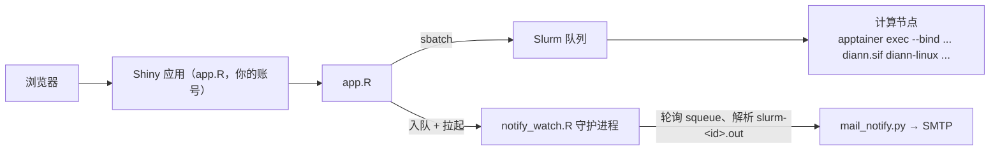

> [English](README.md) | 简体中文

# DIANN GUI

一个把 [DIA-NN](https://github.com/vdemichev/DiaNN) 搬进浏览器的 Shiny 应用：
在网页上构建 DIA-NN 命令、以 Slurm 批处理作业方式提交到 HPC 集群（运行官方
DIA-NN 容器镜像 Apptainer/Singularity `.sif`），并集中监控作业队列、日志与结果。

## 自行部署（推荐方式）

每位用户以**自己的账号**运行自己的一份拷贝：作业以你本人提交、输出归你所有、
文件权限就是普通 Unix 权限——没有第三方运行用户，没有共享队列身份，不需要
管理员配 ACL。

```bash
git clone https://github.com/zhangdong360/diann-gui.git
cd diann_gui
bin/diann-gui --init   # 可选: 按模板生成 ~/.diann_gui/config.R 设置文件
bin/diann-gui          # 启动, 随机端口; 终端会打印访问地址
```

- **远程集群？** 先建 SSH 隧道：`ssh -L <端口>:localhost:<端口> 用户@集群`，
  然后本地浏览器打开 `http://localhost:<端口>`。
- **RStudio Server 用户**：在内置终端里运行 `bin/diann-gui` 即可——RStudio
  会自动代理端口并弹出浏览器窗口。同样以本人身份运行，零管理操作。
- **配置**位于 `~/.diann_gui/config.R`（模板 `config.example.R`；环境变量
  `DIANN_GUI_CONFIG` 指定的文件同样有效）。常用项：`SIF_DIRS` 指向共享只读的
  DIA-NN 镜像目录（如 `/share/app/tools/diann`）、R 包在站点库时设 `EXTRA_LIB`、
  可选的邮件凭据（`~/.diann_gui/mail_config.txt`，也支持 `DIANN_GUI_MAIL_CONF`
  环境变量）。
- **管理员一次性操作**：把 `diann*.sif` 镜像放到全员可读的共享目录（如
  `/share/app/tools/diann`），并把三个 R 包（`shiny`、`shinydashboard`、
  `shinyFiles`）装进系统库或站点库（或让大家 `EXTRA_LIB` 指过去）。仅此而已；
  数据各自放自己的家目录。

中央 shiny-server 部署（固定 URL 的共享实例，所有作业以服务器的运行用户执行）
仍作为部署变体受支持——见[中央部署（shiny-server）](#中央部署shiny-server)。

## 功能特性

- **终端用户零命令行** —— 实验室成员在网页表单里选择 DIA-NN 容器版本、
  RAW/FASTA/谱库文件、输出目录和 80+ 个分组的 DIA-NN 参数，`sbatch`
  脚本由应用自动生成并提交。
- **多版本支持** —— 版本下拉框自动扫描配置目录中的 `diann*.sif` 镜像。
- **命令导入** —— 粘贴现成的 DIA-NN 命令行（如 Windows 端 `diann.exe`
  脚本），GUI 自动识别旗标并回填表单。
- **三级校验** —— ✗ 阻断 / ⚠ 警告 / ℹ 说明，在提交前拦住常见错误
  （RAW 缺失、旗标组合问题、导入残留的裸旗标等）。
- **命令实时预览** —— 提交前可查看完整 DIA-NN 参数与 Slurm 脚本。
- **任务看板** —— `squeue` 自动刷新、`sacct` 历史记录（需开启 Slurm
  记账）、`scancel` 取消，以及按 JobID 自动定位日志的查看器
  （手动目录 → 会话记录 → 持久注册表 → `scontrol` → sacct 工作目录）。
- **邮件通知（可选）** —— 独立守护进程 `notify_watch.R` 轮询队列，作业
  离队后解析退出码并经 `mail_notify.py` 发送完成邮件。用于计算节点
  无出网、Slurm 自带 `--mail-user` 发不出去的集群。
- **参数速查** —— 应用内可搜索的 DIA-NN 旗标参考手册。

## 架构



## 环境要求

| 组件 | 说明 |
|---|---|
| 安装 **Slurm** 的 Linux | 应用通过 `sbatch`/`squeue`/`sacct`/`scancel`/`scontrol` 与集群交互 |
| **R** ≥ 4.0 | 需安装 `shiny`、`shinydashboard`、`shinyFiles` 三个包 |
| **Apptainer 或 Singularity** | 以及一个 DIA-NN 的 `.sif` 容器镜像 |
| **python3** | 可选，仅邮件通知需要（纯标准库） |
| **shiny-server** | 可选——仅"中央部署"变体需要；自行部署用 `bin/diann-gui` 启动 |

## 中央部署（shiny-server）

变体：把**一个共享实例**固定在某个 URL 供多人使用。注意此模式下所有作业都以
shiny-server 的 `run_as` 用户运行（而不是点击的人），跨用户文件访问需要显式的
组/ACL 配置，且全部 GUI 作业共享一个队列身份。自行部署模式没有这些问题。

1. 在运行 shiny-server 的服务器（通常是 Slurm 登录/管理节点）上**克隆**：

   ```bash
   git clone https://github.com/zhangdong360/diann-gui.git
   cd diann_gui
   ```

2. **安装 R 包**（系统级或共享库均可）：

   ```r
   install.packages(c("shiny", "shinydashboard", "shinyFiles"))
   ```

3. **配置** —— 复制模板并按集群实际情况编辑：

   ```bash
   cp config.example.R config.R
   ```

   至少设置 `DATA_HOME`（用户数据所在目录树）与 `SIF_DIRS`（扫描
   `diann*.sif` 的目录）；若数据不在 `$HOME` 下，还需设置 `BIND_PATHS`
   （要绑定进容器的宿主路径）。详见下表。

4. **部署到 shiny-server**，例如软链到站点目录：

   ```bash
   sudo ln -s "$(pwd)" /srv/shiny-server/diann_gui
   ```

   应用目录（及其上级）需对 shiny-server 的 `run_as` 用户可读。

5. 浏览器打开 `http://<服务器>:3838/diann_gui/`。

## 配置项（`config.R`）

所有配置均可选，未设置的项使用内置默认值。

| 配置项 | 用途 | 默认值 |
|---|---|---|
| `EXTRA_LIB` | 依赖包所在的额外 R 库 | *(不设置，用标准 `.libPaths()`)* |
| `SIF_DIRS` | 递归扫描 `diann*.sif` 的目录 | 家目录 |
| `DEFAULT_SIF` | 下拉框默认选中的镜像 | 扫描到的第一个 |
| `DATA_HOME` | 文件浏览器可见的数据树根目录 | 家目录 |
| `CON_FASTA` | 内置污染物（cRAP）FASTA | *(无)* |
| `SLURM_PARTITIONS` | 提交表单可选的分区 | `c("compute")` |
| `APPTAINER_PATHS` | sbatch 脚本内查找 `apptainer` 的目录 | *(空)* |
| `APPTAINER_MODULE_FALLBACK` | 找不到 apptainer 时加载的模块 | *(空，不加载)* |
| `BIND_PATHS` | 绑定进容器的宿主路径（`--bind`） | *(空)* |
| `SHARED_GROUP` | GUI 新建输出目录的共享组（`2770` + setgid + `chgrp`） | *(空，不修复)* |
| `MAIL_PYTHON` | 发信用的 python3 | `PATH` 上的 `python3` |

## 邮件通知（可选）

凭据文件放 `~/.diann_gui/mail_config.txt`（自行部署推荐）或与 app.R 同目录
（中央部署），三处搜索链也可用环境变量 `DIANN_GUI_MAIL_CONF` 指定：

```bash
mkdir -p ~/.diann_gui
cp mail_config.example.txt ~/.diann_gui/mail_config.txt   # 编辑 smtp_host / smtp_user / smtp_pass 等
chmod 600 ~/.diann_gui/mail_config.txt
```

- `smtp_port` 为 `465` 走 SSL，其他端口走 STARTTLS；126/163/QQ 邮箱请填
  SMTP **授权码**而非登录密码。
- 不存在 `mail_config.txt` 时整个功能静默停用：不入队、不拉起 watcher，
  提交表单会提示邮件未启用。
- 用户在提交表单填写邮箱；作业离队后 watcher 解析 `slurm-<jobid>.out`
  中的退出码并发送结果邮件（失败重试 3 次，间隔 5/10/15 分钟）。
- 自测：`python3 mail_notify.py --check`（测连通）/ `--self-test`
  （真发一封测试邮件）；`Rscript notify_watch.R --once` 手动跑一轮
  （也可补发积压邮件）。

## 多用户权限模型

自行部署（推荐）：应用以你本人运行，产出文件归你所有，与命令行行为一致，
通常无需本节。

中央部署变体：应用以 shiny-server `run_as` 用户运行，产出文件归该用户所有。
若实验室成员要用其他账号读取结果（典型场景：`lab` 数据账号持有原始
数据、shiny 运行应用）：

1. 建一个包含双方的共享组，并在 `config.R` 设置 `SHARED_GROUP`。
2. GUI 创建的每一层目录会自动修复到 `DATA_HOME` 为止
   （`chmod 2770` + `chgrp SHARED_GROUP`）——因为
   `dir.create(recursive=TRUE)` 会丢失中间父目录的 setgid 并重置属组。
3. 给运行用户开数据根目录的读权限，例如在数据属主家目录上
   `setfacl -m u:<运行用户>:rx <DATA_HOME>`。

## 文档

- [`docs/DIANN_GUI_新手指南.html`](docs/DIANN_GUI_新手指南.html) ——
  新手图文教程，11 张界面截图，单文件完全离线可用。
- [`docs/DIANN_GUI_技术手册.md`](docs/DIANN_GUI_技术手册.md) ——
  完整技术手册：架构、控件详解、标准工作流、通知机制、故障排查。
- [`docs/DIANN参数说明.md`](docs/DIANN参数说明.md) —— 应用内参数速查页的数据源。

## 测试

纯函数核心（`diann_core.R`）与通知共享逻辑（`notify_common.R`）由 testthat 套件覆盖：

```bash
Rscript -e 'testthat::test_dir("tests/testthat", stop_on_failure = TRUE)'
```

GitHub Actions（`.github/workflows/tests.yaml`）在每次推送时运行：testthat 套件、
合成标识白名单扫描（`tests/check_synthetic_ids.py`）、应用装载冒烟（`shinyAppFile`），
以及浏览器端到端回归（三份真实粘贴夹具）。

真实回归夹具：三份真实用户粘贴（39 / 796 个 RAW 的搜库命令、Windows GUI 预测库命令，
`tests/fixtures/`）由 `tests/testthat/test-import-fixtures.R` 固化——每次运行都会断言
其解析、路径范围与 sbatch 脚本构建。`test-consistency.R` 另设类别级不变量：命令构建↔
解析往返语义等价，旗标映射、UI 控件与导入重置清单三方交叉核对。

**回归约定**：每个生产事故必须在修复的同一批提交里固化一份夹具/契约测试，使同类问题
下次直接被测试拦截，而不是靠人记住。

**脱敏约定**：夹具与文档只允许合成标识（`/share/home/demo`、`demo_sample_NNN.raw`、
`human_proteome*.fasta` 等），禁止真实服务器路径、项目名、样本名与人名缩写入库；
`tests/check_synthetic_ids.py` 在 CI 强制执行。

**每次更新部署前必须执行浏览器端到端验证**（自动起本地实例，把夹具粘贴进导入框，
断言会话存活且 RAW 路径全部进入覆盖层）：

```bash
tests/e2e/run_e2e.sh                # 本地实例 :4849
tests/e2e/run_e2e.sh --url http://localhost:3838/diann_gui/   # 部署后对生产复核
```

依赖 selenium + geckodriver + Firefox（部署机已具备）。

## 月度使用统计

`usage_report.R` 汇总提交注册表，生成 Markdown 报告（逐作业四层状态、状态分布、耗时、失败明细）：

```bash
# 以与 GUI 相同的运行用户执行（需能读注册表）
Rscript usage_report.R --month 2026-10 --out /path/to/reports
```

crontab 示例（每月 1 日统计上月）：

```
0 9 1 * *  Rscript /path/to/usage_report.R --month $(date -d 'last month' +\%Y-\%m) --out /path/to/reports
```

## 许可证

[MIT](LICENSE)

## 致谢

基于 V. Demichev 等开发的 [DIA-NN](https://github.com/vdemichev/DiaNN)；
使用本 GUI 完成的分析请引用 DIA-NN 原文。
