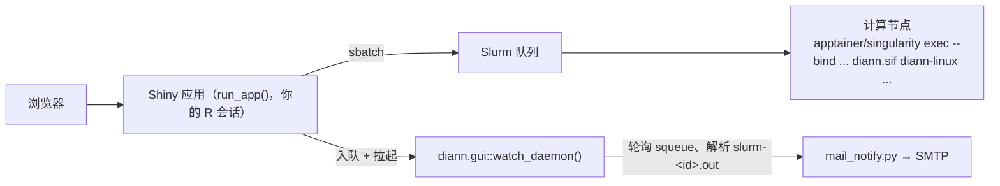

> [English](README.md) | 简体中文

# DIANN GUI

一个以 **R 包**形式分发的 Shiny 应用：把 [DIA-NN](https://github.com/vdemichev/DiaNN)
搬进浏览器——在你的 R 会话里构建 DIA-NN 命令、以 Slurm 批处理作业提交到 HPC
集群（运行官方 DIA-NN 容器镜像 Apptainer/Singularity `.sif`），并监控队列、日志与结果。

> 界面与随包文档为中文；本 README 为中文版。

## 安装与运行（每用户自托管，无需管理员）

每位用户把包装进**自己的 R 库**，在**自己的 R 会话**里运行。作业以你本人提交，
产物归你所有，文件权限就是普通 Unix 权限——没有第三方运行用户，没有共享队列
身份，也不需要管理员配 ACL。

```r
# 1) 装进自己的用户库（三选一）
install.packages("diann.gui", repos = c(SITE = "<站点 drat/miniCRAN>", getOption("repos")))
# 无外网集群（管理员把 tarball 放到共享存储）：
install.packages("/share/app/tools/R/diann.gui_1.11.0.tar.gz", repos = NULL, type = "source")
# 有外网：
remotes::install_github("zhangdong360/diann-gui")

# 2) 载入并自检（可选，推荐）
library(diann.gui)
diann.gui::doctor()

# 3) 运行（自动选空闲端口，打印 URL 与 SSH 隧道提示）
diann.gui::run_app()
```

不需要克隆仓库、不需要 `R CMD INSTALL`、不需要 shell 启动脚本、不需要系统级安装。
应用就是一个 R 包：依赖（`shiny`/`shinydashboard`/`shinyFiles`/`htmltools`）随包一起装。

- **远程集群？** 检测到 SSH 会话时，`run_app()` 会打印可直接粘贴的
  `ssh -L <端口>:127.0.0.1:<端口> 用户@集群` 隧道命令。
- **RStudio Server 用户**：`run_app()` 在 Viewer 面板打开，RStudio 自动代理端口。
- **固定端口**：`run_app(port = 3838)`。
- **RStudio 的 "Run App" 按钮 / `shiny::runApp()`**：仓库根保留了一个可选的
  `app.R` shim（`diann.gui::run_app(app_only = TRUE)`），两种启动方式都继续可用；
  日常使用不需要它，`diann.gui::run_app()` 就是入口。
- **嵌入 / 历史 shiny-server**：`run_app(app_only = TRUE)` 只返回 app 对象，不启动服务。
- **每用户配置**：`diann.gui::init_config()` 生成 `~/.diann_gui/config.R`
  （可自动探测 Slurm 分区、apptainer 候选与常见 `diann*.sif` 目录）；
  环境变量 `DIANN_GUI_CONFIG` 指定的文件同样有效。邮件凭据放
  `~/.diann_gui/mail_config.txt`（也支持 `DIANN_GUI_MAIL_CONF`）。
- **管理员一次性操作**：把 `diann*.sif` 镜像放到全员可读的共享目录
  （如 `/share/app/tools/diann`）。仅此而已——包与依赖随各用户安装，数据各自放
  自己的家目录。

状态文件按用户隔离：`~/diann_gui_notify_state.rds`、`~/diann_gui_jobs_registry.rds`、
watcher 的 pid/日志，以及 `~/.diann_gui/` 下的 apptainer 探测缓存。

## 功能特性

- **终端用户零命令行** —— 在网页表单里选择 DIA-NN 容器版本、apptainer 运行环境、
  RAW/FASTA/谱库文件、输出目录和 80+ 个分组的 DIA-NN 参数，`sbatch` 脚本由应用
  自动生成并提交。
- **apptainer 运行环境选择** —— 自动识别 `apptainer`/`singularity`（PATH、
  `APPTAINER_PATHS`、常见安装位置、conda 环境），逐个解析版本后像 DIA-NN 版本
  下拉一样列入候选；一个都没识别到时自动打开手动路径输入，可「识别并验证」。
  选定路径写入作业脚本作为首选，计算节点不可见时按 候选目录 → PATH → module →
  singularity 回退。
- **多版本支持** —— 版本下拉自动扫描配置目录中的 `diann*.sif` 镜像（按数值版本排序）。
- **命令导入** —— 粘贴现成的 DIA-NN 命令行（如 Windows 端 `diann.exe` 脚本），
  GUI 自动识别旗标并回填表单，含 `--dir`/`--dir-all` 目录模式。
- **三级校验** —— ✗ 阻断 / ⚠ 警告 / ℹ 说明，在提交前拦住常见错误
  （RAW 缺失、旗标组合、导入残留裸旗标、输出目录不可写、apptainer 不可见等）。
- **命令实时预览** —— 提交前可查看完整 DIA-NN 参数与 Slurm 脚本。
- **任务看板** —— `squeue` 自动刷新、`sacct` 历史（需开启 Slurm 记账）、`scancel`
  取消，以及按 JobID 自动定位日志的查看器。
- **四层作业状态** —— Slurm 终态 → 程序退出码（`.rc`）→ 产物验证 → 展示标签
  （成功/失败/待核实/未知），任务面板与完成邮件共用同一判定。
- **邮件通知（可选）** —— 每用户独立守护进程 `diann.gui::watch_daemon()`（自动拉起）
  轮询队列，作业离队后经 `mail_notify.py` 发送完成邮件；适用计算节点无出网的集群。
- **参数速查** —— 应用内可搜索的 DIA-NN 旗标参考手册。

## 架构



## 环境要求

| 组件 | 说明 |
|---|---|
| 安装 **Slurm** 的 Linux | 应用通过 `sbatch`/`squeue`/`sacct`/`scancel`/`scontrol` 与集群交互 |
| **R** ≥ 4.1 | 装进用户库；依赖随包安装 |
| **Apptainer 或 Singularity** | 以及一个 DIA-NN 的 `.sif` 镜像（登录节点可以没有 apptainer，GUI 允许填计算节点专用路径）。**.sif 需要 apptainer ≥ 1.0 或 singularity ≥ 3.0**；2.x 只能读 `.simg` |
| **python3** | 可选，仅邮件通知需要（纯标准库） |

## 配置项（`~/.diann_gui/config.R`）

所有配置均可选，未设置的项使用内置默认值；`diann.gui::init_config()` 可按模板生成。

| 配置项 | 用途 | 默认值 |
|---|---|---|
| `SIF_DIRS` | 递归扫描 `diann*.sif` 的目录 | *(未设置——需配置，或在 GUI 里手输镜像路径)* |
| `DEFAULT_SIF` | 下拉框默认选中的镜像 | 扫描到的第一个 |
| `DATA_HOME` | 文件浏览器可见的数据树根目录 | 家目录 |
| `BASE_VOLUMES` | 文件浏览器暴露的命名根（也是导入路径的安全边界） | `c(Data = DATA_HOME)` |
| `CON_FASTA` | 内置污染物（cRAP）FASTA | *(无)* |
| `SLURM_PARTITIONS` | 提交表单可选的分区 | `c("compute")` |
| `APPTAINER_PATHS` | 扫描 apptainer/singularity 的目录，同时作为作业脚本回退目录 | *(空)* |
| `DEFAULT_APPTAINER` | apptainer 下拉默认选中项 | 版本最高的可用项 |
| `APPTAINER_STRICT_CHECK` | `TRUE` = GUI 节点跑不动所选 apptainer 时阻断提交 | `FALSE`（仅警告） |
| `APPTAINER_MODULE_FALLBACK` | 找不到 apptainer 时加载的环境模块 | *(空，不加载)* |
| `BIND_PATHS` | 绑定进容器的宿主路径（`--bind`） | *(空)* |
| `SHARED_GROUP` | legacy 共享输出组修复（多账号共享实例） | *(空，关闭)* |
| `MAIL_PYTHON` | 发信用的 python3 | `PATH` 上的 `python3` |

## apptainer 运行环境

GUI 第一个面板「1. apptainer 运行环境」启动时自动填充：

- 从 `PATH`、`APPTAINER_PATHS`、`/usr/bin`、`/usr/local/bin`、`/opt/apptainer/bin`、
  `$HOME` 下的 conda 环境等位置发现候选；
- 逐个 `--version` 解析版本（缓存 24 h，按 mtime/size 失效），多版本像 SIF 下拉一样列出；
- 一个都没识别到时自动展开手动路径输入，「识别并验证」会显示解析到的版本；
- 选中路径写入 sbatch 脚本；计算节点看不到该路径时按
  `APPTAINER_PATHS` → `PATH` → `module load` → `singularity` 回退。

**版本要求：`.sif` 需要 apptainer ≥ 1.0 或 singularity ≥ 3.0**（SIF 自 Singularity 3.0
起）。`singularity 2.x` 能执行 `--version`，但只认 squashfs/ext3 的 `.simg`，对 `.sif`
会报 `Unknown image format/type`；候选下拉/自检面板/验证/提交前校验都会标注
「⚠ 不支持 SIF」，提交时直接阻断。

## 邮件通知（可选）

```bash
mkdir -p ~/.diann_gui
cp /path/to/inst/config/mail_config.example.txt ~/.diann_gui/mail_config.txt
chmod 600 ~/.diann_gui/mail_config.txt
```

- `smtp_port` 为 `465` 走 SSL，其他端口走 STARTTLS（STARTTLS 失败会直接报错，
  不会回退明文发送凭据）；126/163/QQ 邮箱请填 SMTP **授权码**而非登录密码。
- 不存在 `mail_config.txt` 时整个功能静默停用：不入队、不拉起 watcher。
- 自测：`python3 mail_notify.py --check` / `--self-test`（脚本路径见
  `system.file("python", "mail_notify.py", package = "diann.gui")`）；
  `Rscript -e 'diann.gui::watch_daemon(once = TRUE)'` 手动跑一轮。

## 文档

- [`docs/DIANN_GUI_新手指南.html`](docs/DIANN_GUI_新手指南.html) ——
  新手图文教程，单文件完全离线可用。
- [`docs/DIANN_GUI_技术手册.md`](docs/DIANN_GUI_技术手册.md) ——
  完整技术手册：架构、控件详解、标准工作流、通知机制、故障排查。
- [`inst/docs/DIANN_param_reference.md`](inst/docs/DIANN_param_reference.md) ——
  应用内参数速查页的数据源。

## 测试

```bash
Rscript -e 'testthat::test_dir("tests/testthat", stop_on_failure = TRUE)'
python3 -m unittest discover -s tests/python
```

GitHub Actions 在每次推送时运行：testthat 套件、Python 单测、合成标识白名单扫描、
`R CMD check`、包级启动冒烟，以及浏览器端到端回归（三份真实粘贴夹具 + apptainer 选择）。

真实回归夹具（39 / 796 个 RAW 的搜库命令、Windows GUI 预测库命令、目录模式命令，
`tests/fixtures/`）由 `tests/testthat/test-import-fixtures.R` 固化；
`test-consistency.R` 另设类别级不变量（命令构建↔解析往返、旗标映射/UI/重置清单三方核对）。

**回归约定**：每个生产事故必须在修复的同一批提交里固化一份夹具/契约测试。

**脱敏约定**：夹具与文档只允许合成标识（`/share/home/demo`、`demo_sample_NNN.raw`、
`human_proteome*.fasta` 等）；`tests/check_synthetic_ids.py` 在 CI 强制执行。

浏览器端到端验证（自动起本地实例、粘贴夹具、检查 apptainer 面板）：

```bash
tests/e2e/run_e2e.sh
tests/e2e/run_e2e.sh --url http://localhost:3838/diann_gui/   # 部署后对生产复核
```

依赖 selenium + geckodriver + Firefox。

## 月度使用统计

```bash
Rscript -e 'diann.gui::usage_report(month = "2026-10", out_dir = "/path/to/reports")'
```

crontab 示例（每月 1 日统计上月）：

```
0 9 1 * *  Rscript -e 'diann.gui::usage_report(month = format(Sys.Date() - 1, "%Y-%m"), out_dir = "/path/to/reports")'
```

## legacy：中央 shiny-server 部署（不推荐）

一个共享实例、所有作业以 shiny-server 的 `run_as` 用户运行——**没有用户隔离**，
且所有用户共享同一份通知记录。仅在无法每用户安装时使用。入口：

```r
# 站点目录下的 app.R（同目录需有 config.R）
diann.gui::run_app(app_only = TRUE)
```

站点配置示例（已脱敏）见
[`docs/legacy/shiny-server-config.example.R`](docs/legacy/shiny-server-config.example.R)。

## 许可证

[MIT](LICENSE)

## 致谢

基于 V. Demichev 等开发的 [DIA-NN](https://github.com/vdemichev/DiaNN)；
使用本 GUI 完成的分析请引用 DIA-NN 原文。
