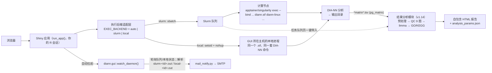

> [English](README.md) | 简体中文

# DIANN GUI

一个以 **R 包**形式分发的 Shiny 应用：把 [DIA-NN](https://github.com/vdemichev/DiaNN)
搬进浏览器——在你的 R 会话里构建 DIA-NN 命令，以 Slurm 批处理作业提交到 HPC
集群，**或直接在本地 Linux 主机上运行**（两种模式都运行官方 DIA-NN 容器镜像
Apptainer/Singularity `.sif`），并监控队列、日志与结果。v1.12 起 Slurm 变为可选
执行后端：默认自动检测，也可显式固定为 `slurm` 或 `local`。

> 界面与随包文档为中文；本 README 为中文版。

## 安装与运行（每用户自托管，无需管理员）

每位用户把包装进**自己的 R 库**，在**自己的 R 会话**里运行。作业以你本人提交，
产物归你所有，文件权限就是普通 Unix 权限——没有第三方运行用户，没有共享队列
身份，也不需要管理员配 ACL。

```r
# 1) 装进自己的用户库（三选一）
install.packages("diann.gui", repos = c(SITE = "<站点 drat/miniCRAN>", getOption("repos")))
# 无外网集群（管理员把 tarball 放到共享存储）：
install.packages("/share/app/tools/R/diann.gui_1.12.0.tar.gz", repos = NULL, type = "source")
# 有外网：
remotes::install_github("zhangdong360/diann-gui")

# 2) 载入并自检（可选，推荐）
library(diann.gui)
diann.gui::doctor()

# 3) 运行（自动选空闲端口，打印 URL 与 SSH 隧道提示）
diann.gui::run_app()
```

不需要克隆仓库、不需要 `R CMD INSTALL`、不需要 shell 启动脚本、不需要系统级安装。
应用就是一个 R 包：依赖（`shiny`/`shinydashboard`/`shinyFiles`/`htmltools`）随包一起装。

- **远程集群？** 检测到 SSH 会话时，`run_app()` 会打印可直接粘贴的
  `ssh -L <端口>:127.0.0.1:<端口> 用户@集群` 隧道命令。
- **RStudio Server 用户**：`run_app()` 在 Viewer 面板打开，RStudio 自动代理端口。
- **固定端口**：`run_app(port = 3838)`。
- **RStudio 的 "Run App" 按钮 / `shiny::runApp()`**：仓库根保留了一个可选的
  `app.R` shim（`diann.gui::run_app(app_only = TRUE)`），两种启动方式都继续可用；
  日常使用不需要它，`diann.gui::run_app()` 就是入口。
- **嵌入 / 自定义启动器**：`run_app(app_only = TRUE)` 只返回 app 对象，不启动服务。
- **每用户配置**：`diann.gui::init_config()` 生成 `~/.diann_gui/config.R`
  （自动探测执行后端 `slurm`/`local`，以及 Slurm 分区、apptainer 候选与常见
  `diann*.sif` 目录）；环境变量 `DIANN_GUI_CONFIG` 指定的文件同样有效，
  `DIANN_GUI_EXEC_BACKEND` 可临时覆盖 `EXEC_BACKEND` 而不必改文件。邮件凭据放
  `~/.diann_gui/mail_config.txt`（也支持 `DIANN_GUI_MAIL_CONF`）。
- **管理员一次性操作**：把 `diann*.sif` 镜像放到全员可读的共享目录
  （如 `/share/app/tools/diann`）。仅此而已——包与依赖随各用户安装，数据各自放
  自己的家目录。

状态文件按用户隔离：`~/diann_gui_notify_state.rds`、`~/diann_gui_jobs_registry.rds`、
watcher 的 pid/日志，以及 `~/.diann_gui/` 下的 apptainer 探测缓存。本地模式另有
`~/diann_gui_local_jobs.rds`（作业记录，最近 300 条）与 `~/diann_gui_local_seq`
（本地作业号序列），与通知状态文件同目录。

## 功能特性

- **终端用户零命令行** —— 在网页表单里选择 DIA-NN 容器版本、apptainer 运行环境、
  RAW/FASTA/谱库文件、输出目录和 80+ 个分组的 DIA-NN 参数，作业脚本由应用自动
  生成并提交（Slurm 批处理作业或本地进程）。
- **执行后端可选（v1.12）** —— `EXEC_BACKEND` = `auto`（默认）| `slurm` | `local`，
  可用环境变量 `DIANN_GUI_EXEC_BACKEND` 覆盖。`auto` 在 PATH 上有 `sbatch` 时用
  Slurm（与 v1.11 行为一致），没有则在本机运行。两种后端使用**同一套**生成的
  DIA-NN 命令与**同一个** `.sif` 镜像——只是执行器不同。安全阀：`auto` 在检测到
  Slurm 痕迹但没有 `sbatch` 时拒绝回退本地（保护 HPC 登录节点）。
- **apptainer 运行环境选择** —— 自动识别 `apptainer`/`singularity`（PATH、
  `APPTAINER_PATHS`、常见安装位置、conda 环境），逐个解析版本后像 DIA-NN 版本
  下拉一样列入候选；一个都没识别到时自动打开手动路径输入，可「识别并验证」。
  选定路径写入作业脚本作为首选，计算节点不可见时按 候选目录 → PATH → module →
  singularity 回退。
- **多版本支持** —— 版本下拉自动扫描配置目录中的 `diann*.sif` 镜像（按数值版本排序）。
- **命令导入** —— 粘贴现成的 DIA-NN 命令行（如 Windows 端 `diann.exe` 脚本），
  GUI 自动识别旗标并回填表单，含 `--dir`/`--dir-all` 目录模式。
- **三级校验** —— ✗ 阻断 / ⚠ 警告 / ℹ 说明，在提交前拦住常见错误
  （RAW 缺失、旗标组合、导入残留裸旗标、输出目录不可写、apptainer 不可见等）。
- **命令实时预览** —— 提交前可查看完整 DIA-NN 参数与作业脚本（Slurm 头 + 共享
  程序体，或本地执行脚本）。
- **任务看板** —— Slurm 模式为 `squeue` 自动刷新，本地模式为本地作业列表；
  `sacct` 历史（需开启 Slurm 记账）、`scancel` / 本地进程组取消，以及按 JobID
  自动定位日志的查看器（按后端识别 `slurm-<JobID>.out` 或 `local-<JobID>.out`）。
- **四层作业状态** —— 调度态（Slurm 终态，或映射为同名状态的本地进程态）→ 程序
  退出码（`.rc`）→ 产物验证 → 展示标签（成功/失败/待核实/未知），任务面板与完成
  邮件共用同一判定。
- **邮件通知（可选）** —— 每用户独立守护进程 `diann.gui::watch_daemon()`（自动拉起）
  轮询执行后端（Slurm 队列或本地作业状态文件），作业结束后经 `mail_notify.py`
  发送完成邮件；适用计算节点无出网的集群。
- **结果分析（v1.14）** —— 「结果分析」页直接消费 DIA-NN `--matrices` 导出的蛋白矩阵
  （pg_matrix）：预处理（污染/反库剔除、低检出过滤、log2、LoD/KNN/seqKNN 插补、
  样本中位数归一化、可选 ComBat 去批次）→ 9 张 QC 图 → limma 差异分析
  （2 组单对比；≥3 组自动全局 F 检验 + 全部两两对比）→ GO/KEGG 富集 → 一键生成
  自包含 HTML 报告。任务队列页可把已完成作业的矩阵一键带入；也可用
  `run_app(analysis_only = TRUE)` 在无容器环境单独启动分析页。
- **参数速查** —— 应用内可搜索的 DIA-NN 旗标参考手册。

## 架构



> 结果分析依赖（ggplot2 / limma / clusterProfiler 等）为可选包：不安装不影响
> 提交与监控主链，进入分析页时会给出可复制的安装命令；`doctor()` 的
> 「结果分析依赖」组做整体体检。

## 环境要求

| 组件 | 说明 |
|---|---|
| **Linux** | 任意 x86_64 Linux 主机即可自托管运行（无需管理员） |
| **Slurm** | *可选*——仅 `slurm` 后端需要（`sbatch`/`squeue`/`sacct`/`scancel`/`scontrol`）。`EXEC_BACKEND=auto` 在 PATH 上有 `sbatch` 时用 Slurm，否则在 GUI 所在主机本地执行 |
| 本地执行工具 | 本地模式需要 `bash`、`nohup`、`timeout`；建议有 `setsid`（缺失时取消退化为子树 kill），且 `/proc` 可读 |
| **R** ≥ 4.1 | 装进用户库；依赖随包安装 |
| **Apptainer 或 Singularity** | 以及一个 DIA-NN 的 `.sif` 镜像（登录节点可以没有 apptainer，GUI 允许填计算节点专用路径）。**.sif 需要 apptainer ≥ 1.0 或 singularity ≥ 3.0**；2.x 只能读 `.simg` |
| **python3** | 可选，仅邮件通知需要（纯标准库） |
| 分析依赖（ggplot2/limma 等） | *可选*——仅「结果分析」页需要；缺失时该页给出安装命令，不影响提交/监控 |

## 配置项（`~/.diann_gui/config.R`）

所有配置均可选，未设置的项使用内置默认值；`diann.gui::init_config()` 可按模板生成。
`SLURM_*` 配置仅 Slurm 后端使用，`LOCAL_*` 仅本地后端使用；`EXEC_BACKEND` 可用
环境变量 `DIANN_GUI_EXEC_BACKEND` 临时覆盖。

| 配置项 | 用途 | 默认值 |
|---|---|---|
| `SIF_DIRS` | 递归扫描**全部 `*.sif`**（文件名无关）的目录 | *(未设置——需配置，或在 GUI 里手输镜像路径)* |
| `DEFAULT_SIF` | 下拉框默认选中的镜像 | 扫描到的第一个 |
| `DATA_HOME` | 文件浏览器可见的数据树根目录 | 家目录 |
| `BASE_VOLUMES` | 文件浏览器暴露的命名根（也是导入路径的安全边界） | `c(Data = DATA_HOME)` |
| `CON_FASTA` | 内置污染物（cRAP）FASTA | *(无)* |
| `SLURM_PARTITIONS` | 提交表单可选的分区 | `c("compute")` |
| `APPTAINER_PATHS` | 扫描 apptainer/singularity 的目录，同时作为作业脚本回退目录 | *(空)* |
| `DEFAULT_APPTAINER` | apptainer 下拉默认选中项 | 版本最高的可用项 |
| `APPTAINER_STRICT_CHECK` | `TRUE` = GUI 节点跑不动所选 apptainer 时阻断提交 | `FALSE`（仅警告） |
| `APPTAINER_MODULE_FALLBACK` | 找不到 apptainer 时加载的环境模块 | *(空，不加载)* |
| `BIND_PATHS` | 绑定进容器的宿主路径（`--bind`） | *(空)* |
| `EXEC_BACKEND` | 执行后端：`"auto"`（自动检测）/ `"slurm"` / `"local"` | `"auto"` |
| `LOCAL_REQUIRE_EXCLUSIVE_HOST` | `auto` 模式安全阀：检测到 Slurm 痕迹但没有 `sbatch` 时拒绝回退本地（防 HPC 登录节点误跑） | `TRUE` |
| `LOCAL_NICE` | 本地作业进程的 `nice` 值 | `10` |
| `LOCAL_TIMEOUT_GRACE` | 本地作业到时限后 SIGTERM→SIGKILL 的等待秒数 | `30` |
| `LOCAL_MAX_JOBS` | 本地并发上限：`0`=不限；`>0` 达到后阻断新提交（不排队） | `0` |
| `LOCAL_MEM_ADVISORY` | 提交前按 `/proc/meminfo` 比对申请内存（仅警告，本地无法强制） | `TRUE` |
| `MAIL_PYTHON` | 发信用的 python3 | `PATH` 上的 `python3` |

## apptainer 运行环境

GUI 第一个面板「1. apptainer 运行环境」启动时自动填充：

- 从 `PATH`、`APPTAINER_PATHS`、`/usr/bin`、`/usr/local/bin`、`/opt/apptainer/bin`、
  `$HOME` 下的 conda 环境等位置发现候选；
- 逐个 `--version` 解析版本（缓存 24 h，按 mtime/size 失效），多版本像 SIF 下拉一样列出；
- 一个都没识别到时自动展开手动路径输入，「识别并验证」会显示解析到的版本；
- 选中路径写入 sbatch 脚本；计算节点看不到该路径时按
  `APPTAINER_PATHS` → `PATH` → `module load` → `singularity` 回退。

**版本要求：`.sif` 需要 apptainer ≥ 1.0 或 singularity ≥ 3.0**（SIF 自 Singularity 3.0
起）。`singularity 2.x` 能执行 `--version`，但只认 squashfs/ext3 的 `.simg`，对 `.sif`
会报 `Unknown image format/type`；候选下拉/自检面板/验证/提交前校验都会标注
「⚠ 不支持 SIF」，提交时直接阻断。

## 构建 DIA-NN 容器镜像（`.sif`）

GUI 不分发 DIA-NN 二进制、镜像或构建脚本——**每个使用者按 DIA-NN 官方说明自行
构建 `.sif`**（学术使用免费；二进制/镜像不允许再分发——见维护者在
[DiaNN issue #1202](https://github.com/vdemichev/DiaNN/issues/1202) 的说明）。
官方渠道（构建步骤以官方说明为准，本文档不复述）：

- 官方仓库 README（https://github.com/vdemichev/DiaNN ）——release 附带镜像构建
  脚本，README 说明如何用 apptainer/singularity 把 Docker 镜像转成 `.sif`；
- [DiaNN issue #1202](https://github.com/vdemichev/DiaNN/issues/1202) ——社区
  维护的 Dockerfile 讨论。

**本项目对镜像的硬性要求**（这是我们唯一的契约）：

1. DIA-NN 二进制目录必须在**容器内 `PATH`** 上——GUI 以裸命令 `diann-linux`
   调用，缺 PATH 时作业报"容器内找不到 diann-linux"；
2. 构建后自验：`apptainer exec diann-<版本>.sif diann-linux --version` 必须输出
   `DIA-NN <版本> …`；
3. `.sif` 放到计算节点可见的共享存储并将其目录加入 `SIF_DIRS`——**文件名任意**：
   v1.13 起 GUI 扫描全部 `*.sif`、在容器内实测真实版本（按 size+mtime 缓存）、
   按数值排序（2.10.0 在 2.9.1 之前）并默认选中已识别的最高版本。

运行时注意：apptainer 需以 root 安装（`.deb`）或使用管理员构建的 conda 环境；
GUI 节点与计算节点都要能看到。计算节点看不到时把路径配进 `APPTAINER_PATHS`——
生成的作业脚本已内置 `APPTAINER_PATHS` → `PATH` → `module load` → `singularity`
回退链。**不要分发**构建出的 `.sif`（或任何 DIA-NN 二进制）；每人自行构建。

## 单机模式（无 Slurm）

v1.12 起应用不再依赖 Slurm。默认 `EXEC_BACKEND = "auto"`：

- PATH 上有 `sbatch` → 与 v1.11 完全一样提交到 Slurm 集群；
- 没有 `sbatch` → 作业在 **GUI 所在主机以本地进程运行**，没有调度器、没有排队。
  标题栏会显示「执行后端: 本地单机」。

本地模式仍然使用 Apptainer/Singularity 与同一个 `diann*.sif` 镜像，DIA-NN 命令与
容器配置和 Slurm 模式一致，区别只在执行器：

| 方面 | 本地模式 |
|---|---|
| 运行位置 | 运行 `run_app()` 的 Linux 主机 |
| 作业身份 | 整数 ID，从 `1000001` 起（按用户持久化） |
| 日志 | `<输出目录>/local-<作业ID>.out` / `.err`（Slurm 模式仍是 `slurm-<作业ID>.out` / `.err`） |
| 脚本 | 仍保存到 `<输出目录>/diann_gui_scripts/`，退出码写 `<脚本>.rc` |
| 生命周期 | `setsid`+`nohup` 派生，脱离浏览器会话；关闭页面不影响作业 |
| 时限 | 由 `timeout` 强制（`rc=124` → 超时）；`LOCAL_TIMEOUT_GRACE` 控制 TERM→KILL 间隔 |
| 内存 | 只做建议检查：提交前与 `/proc/meminfo` 比对，不强制限制 |
| CPU | 由 `--threads` 决定；无调度器记账 |
| 排队 | 无排队；`LOCAL_MAX_JOBS` 可做简单并发上限（达到后直接阻断提交） |
| 取消 | 终止本地进程组（有同 UID 校验）；状态变「已取消」 |
| 状态 / 邮件 / 月报 | 与 Slurm 模式共用同一套四层状态合成、通知 watcher 与 `usage_report()` |

本地模式界面差异：标题栏「执行后端: 本地单机」；资源盒改名「6. 运行资源 (本地)」
且没有分区；提交按钮为「提交本地任务」；监控页隐藏 `sinfo` 节点资源盒，标题为
「本地运行任务」/「近期历史 (本地作业)」；日志查看器定位 `local-<ID>.out`。
Slurm 模式界面与 v1.11 基本一致，现有截图仍然有效。

**HPC 登录节点有保护**：如果本机像 Slurm 节点（PATH 上有
`squeue`/`sacct`/`scontrol`/`sinfo`，或存在 `/etc/slurm*`、设置了 `SLURM_CONF`）
但没有 `sbatch`，`auto` 会拒绝静默本地执行，`run_app()` 启动时报错并给出说明。
请先加载 Slurm 模块 / 修正 `PATH`（推荐）；确认本机确实是单机服务器后，再显式
固定后端：

```r
# ~/.diann_gui/config.R
EXEC_BACKEND <- "local"
# 或仅本次启动生效（在 run_app() 之前）：
# Sys.setenv(DIANN_GUI_EXEC_BACKEND = "local")
```


本版不做：原生二进制（不用容器）、云执行器、Windows、PBS/LSF。本地模式仅支持
Linux，且和 Slurm 模式一样仍然需要 Apptainer/Singularity 与 `.sif` 镜像。

## 结果分析（下游蛋白矩阵分析，v1.14）

「结果分析」页把 DIA 数据的下游统计搬进同一个 GUI：输入是 DIA-NN
`--matrices` 导出的**蛋白水平矩阵**（`*pg_matrix*.tsv`，Spectronaut `PG.*`
矩阵亦可），输出是可发表的 HTML 报告。

**工作流**（页内 6 个子页签）：

1. **① 数据与分组** —— 填写矩阵路径（服务端共享存储直接读取，不走上传）；
   自动识别注释列与样本列、自动推断分组，可编辑分组表双击修正，
   支持 Excel 粘贴批量填入；可选 ComBat 去批次（批次表粘贴/按顺序生成）。
2. **② 预处理** —— 处理明细与告警实时刷新；缺失机制诊断图辅助判断
   MAR/MNAR，从而选择插补方法。
3. **③ QC 可视化** —— 检出数、缺失率、PCA、样本相关性热图、层次聚类、
   组内 CV 分布与重复性箱线图、归一化前后对比；可打包导出 SVG。
4. **④ 差异分析** —— limma 经验贝叶斯；2 组单对比，≥3 组自动全局 F 检验 +
   全部两两对比（火山图/数量统计/Z-score 热图/关键蛋白箱线/结果表）。
5. **⑤ 功能富集** —— GO (BP/MF/CC)；KEGG 数据源可选**本地 KEGG.db**
   （默认，与 CLI 版一致；该包已被 Bioconductor 移除，缺失时自动降级为仅 GO）
   或**在线 enrichKEGG**（需联网，物种更全）。
6. **⑥ 生成报告** —— 生成 `analysis_report_<时间戳>/`（report.html、data/
   图形与结果表、assets、`analysis_params.json` 参数快照、`08_summary_report.md`），
   页面内 iframe 预览、新窗口打开、zip 下载。

**与运行管理页的闭环**：任务队列页的「结果分析入口」从提交记录里选定已完成
作业，自动发现其输出目录内的蛋白矩阵（`pg_matrix` 优先），点「进入下游分析」
即带入路径——raw → DIA-NN → 矩阵 → 统计 → 报告全程不出浏览器。

**独立启动模式**（无 Slurm/apptainer 的机器）：

```r
diann.gui::run_app(analysis_only = TRUE)
```

**依赖**：结果分析的全部依赖为可选（Suggests + 运行时检查）。QC 层
（ggplot2/ggrepel/gridExtra/pheatmap/scales/svglite）与差异层（limma/openxlsx）
较轻；富集层需 clusterProfiler + AnnotationDbi + 物种注释库（org.Hs/Mm/Rn.eg.db，
按需安装）。缺失时页面顶部与 `doctor()` 给出可复制的安装命令；可编辑分组表
还需 DT。不装任何分析依赖时，主界面的提交/监控功能完全不受影响。

## 邮件通知（可选）

```bash
mkdir -p ~/.diann_gui
cp /path/to/inst/config/mail_config.example.txt ~/.diann_gui/mail_config.txt
chmod 600 ~/.diann_gui/mail_config.txt
```

- `smtp_port` 为 `465` 走 SSL，其他端口走 STARTTLS（STARTTLS 失败会直接报错，
  不会回退明文发送凭据）；126/163/QQ 邮箱请填 SMTP **授权码**而非登录密码。
- 不存在 `mail_config.txt` 时整个功能静默停用：不入队、不拉起 watcher。
- 自测：`python3 mail_notify.py --check` / `--self-test`（脚本路径见
  `system.file("python", "mail_notify.py", package = "diann.gui")`）；
  `Rscript -e 'diann.gui::watch_daemon(once = TRUE)'` 手动跑一轮。

## 故障排查

**`run_app()` 启动报错：`auto` 模式拒绝对本地执行做回退。**
本机有 Slurm 痕迹（客户端命令或 `/etc/slurm*`）但 `sbatch` 不在 `PATH` 上。应用
拒绝在很可能是 HPC 登录节点的机器上静默跑计算任务。修正 `PATH` / 加载 Slurm
模块后重启即可；确认是真正的单机服务器时，才用 `EXEC_BACKEND <- "local"`（或
`DIANN_GUI_EXEC_BACKEND=local`）显式覆盖。

**本地模式提交被拦：apptainer 校验失败。**
本地模式作业在 GUI 主机上运行，所选 apptainer 运行时必须真的可用——提交前会做
真实的 `--version`/SIF 校验，失败直接阻断（Slurm 模式允许「计算节点专用路径」，
只警告）。请在「1. apptainer 运行环境」中选择并验证一个可用的
apptainer/singularity，或改用 Slurm 集群提交。

**本地作业的日志在哪？**
本地作业写 `<输出目录>/local-<作业ID>.out` 与 `.err`——不是
`slurm-<作业ID>.out`。日志查看器会按作业记录的后端自动识别文件名；本地作业 ID
从 `1000001` 起。生成的脚本、`.rc` 退出码与 `_desc.txt` 项目简介都在
`<输出目录>/diann_gui_scripts/` 下。

**本地作业显示「超时」，但 DIA-NN 其实还在跑。**
本地时限由 `timeout` 强制（退出码 124 → 超时），`time_h` 给得太小就会杀掉进程。
不设时限即不限时，或把时限调大。

**可以同时有 Slurm 作业和本地作业吗？**
可以。每次提交都在注册表（schema v3）里记录后端；任务面板、邮件 watcher 与
`usage_report(month=...)` 都能处理两种后端的记录（本地作业历史保留最近 300 条）。
v1.11 及更早的旧注册表按 Slurm 记录读取。

## 文档

- [`docs/DIANN_GUI_新手指南.html`](docs/DIANN_GUI_新手指南.html) ——
  新手图文教程，单文件完全离线可用。
- [`docs/DIANN_GUI_技术手册.md`](docs/DIANN_GUI_技术手册.md) ——
  完整技术手册：架构、控件详解、标准工作流、通知机制、故障排查。
- **应用内参数速查**：v1.13 起 DIA-NN 文档快照不再随包分发（版权归 DIA-NN
  作者、条款不允许再分发）。如需启用应用内参数速查，请自行从官方仓库获取
  命令行参考，存为工作目录下的 `DIANN_param_reference.md`——GUI 会自动读取。

## 测试

```bash
Rscript -e 'testthat::test_dir("tests/testthat", stop_on_failure = TRUE)'
python3 -m unittest discover -s tests/python
```

GitHub Actions 在每次推送时运行：testthat 套件、Python 单测、合成标识白名单扫描、
`R CMD check`、包级启动冒烟，以及浏览器端到端回归（三份真实粘贴夹具 + apptainer 选择）。

真实回归夹具（39 / 796 个 RAW 的搜库命令、Windows GUI 预测库命令、目录模式命令，
`tests/fixtures/`）由 `tests/testthat/test-import-fixtures.R` 固化；
`test-consistency.R` 另设类别级不变量（命令构建↔解析往返、旗标映射/UI/重置清单三方核对）。

`test-backend.R` 离线覆盖两种执行后端（假 apptainer + 假 DIA-NN 负载，不依赖真实
Slurm/容器/RAW 数据）：后端解析与 auto 检测、日志命名契约、两种后端共用的脚本
程序体、本地提交→成功/失败/超时/取消、PID 复用防护，以及「无 `sbatch` 时提交
必须返回错误而不是让 Shiny 会话崩掉」。CI 在无 Slurm 的 runner 上执行本地提交路径。

**回归约定**：每个生产事故必须在修复的同一批提交里固化一份夹具/契约测试。

**脱敏约定**：夹具与文档只允许合成标识（`/share/home/demo`、`demo_sample_NNN.raw`、
`human_proteome*.fasta` 等）；`tests/check_synthetic_ids.py` 在 CI 强制执行。

浏览器端到端验证（自动起本地实例，覆盖 4 组：命令导入 / apptainer 运行环境 / 本地执行后端 / 结果分析页（合成矩阵 → QC → 报告））：

```bash
tests/e2e/run_e2e.sh
tests/e2e/run_e2e.sh --url http://localhost:3838/diann_gui/   # 部署后对生产复核
```

依赖 selenium + geckodriver + Firefox。

## 月度使用统计

```bash
Rscript -e 'diann.gui::usage_report(month = "2026-10", out_dir = "/path/to/reports")'
```

报告中逐作业带「后端」列（Slurm / 本地），混合两种后端的记录分别统计。

crontab 示例（每月 1 日统计上月）：

```
0 9 1 * *  Rscript -e 'diann.gui::usage_report(month = format(Sys.Date() - 1, "%Y-%m"), out_dir = "/path/to/reports")'
```

## v1.13 已移除：legacy 中央 shiny-server 部署

v1.13 删除了 legacy 中央 shiny-server 共享账号部署（一个共享实例、所有作业以
`run_as` 用户运行——没有用户隔离）。请改用每用户自托管：每个用户把包装进自己的
库、在自己的 R 会话里运行 `diann.gui::run_app()`，作业以本人身份提交。同事需要
读取输出目录时，用标准 Unix 组/ACL 授权即可。确需中央部署请继续使用 v1.12 或
`central-shiny-server` 分支（保留作历史存档）。


## 许可证

[MIT](LICENSE)

## 致谢

基于 V. Demichev 等开发的 [DIA-NN](https://github.com/vdemichev/DiaNN)；
使用本 GUI 完成的分析请引用 DIA-NN 原文。
